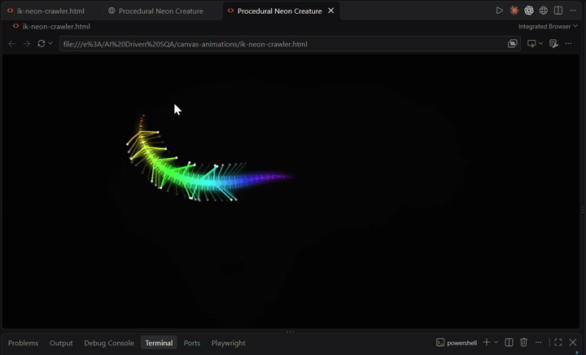

# 🦎 Procedural Neon Creature (Inverse Kinematics)


An interactive, mouse-tracking procedural creature animation built from scratch using **HTML5 Canvas** and **Vanilla JavaScript**—with zero external physics or graphics libraries.

---

## 🎥 Visual Preview

> **What is it & how does it behave?**  
> Set against a pitch-black canvas, a glowing neon reptile-like creature actively tracks and chases your mouse cursor. As you move the cursor, its multi-segmented spine ripples with fluid, lifelike motion while its legs dynamically calculate knee bends and step forward automatically across the screen.



---

## 🚀 Live Demo

👉 **[Click Here to Interact with the Creature Live](https://jobaelhaquearif.github.io/canvas-animations/)**

---

## ✨ Key Features & Mechanics

* **🎯 Real-Time Mouse Tracking:** The creature's head segment continuously tracks cursor coordinates (`X, Y`) and steers smoothly toward the pointer.
* **🐍 Procedural Spine Kinematics:** A chain of 35 interconnected segments follows the head using forward kinematics, maintaining fixed joint distances to produce organic, snake-like undulation.
* **🦿 2-Bone Inverse Kinematics (IK) Legs:** Each leg monitors its distance from an ideal resting anchor. Once stretched beyond its reach threshold, it triggers a smooth stepping animation and solves 2-bone knee bending in real time.
* **🌈 Dynamic Neon Glow (HSL):** Utilizes time-based `HSL` color cycling paired with canvas `shadowBlur` to render a vibrant, glowing neon trail.
* **⚡ Zero Dependencies:** Written in pure, self-contained HTML5, CSS3, and Vanilla JavaScript inside a single file.

---

## 🧠 How It Works (Architecture)

```text
Mouse Movement (Input)
       │
       ▼
[ Head Segment ] ──► Steers toward cursor coordinates
       │
       ▼
[ Spine Chain ]  ──► Each segment follows the previous one (Forward Kinematics)
       │
       ▼
[ Leg System ]   ──► Checks reach distance & solves knee bend (Inverse Kinematics)
       │
       ▼
[ HTML5 Canvas ] ──► Renders glowing neon ribs, joints, and motion trail